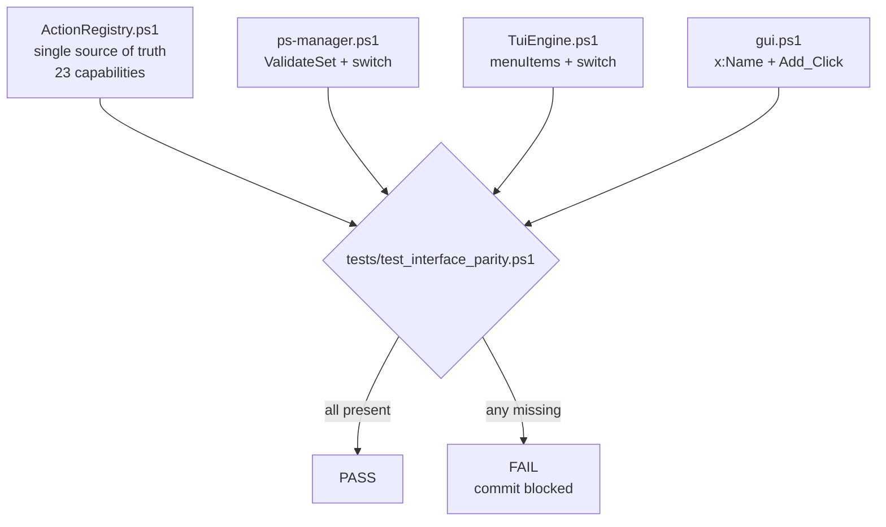
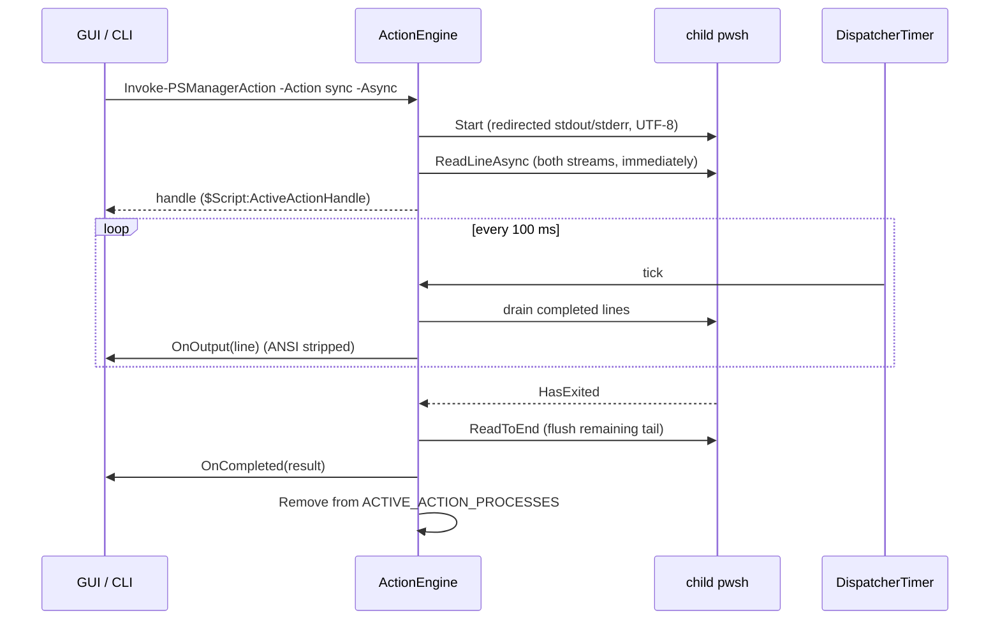
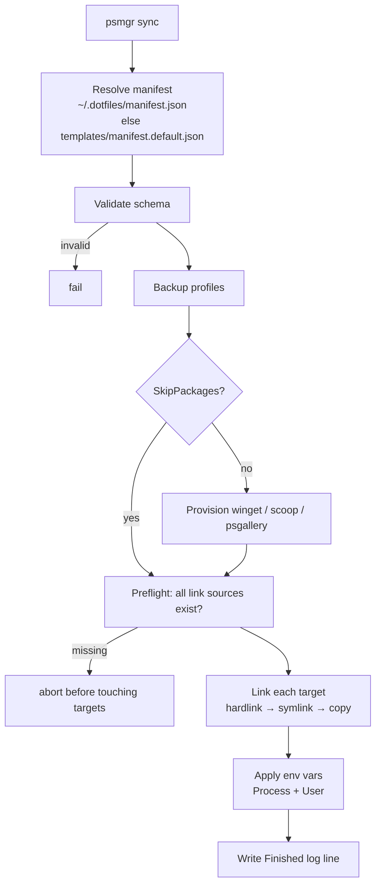
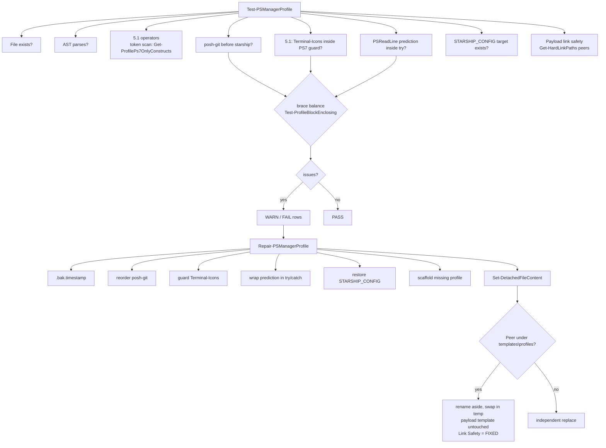
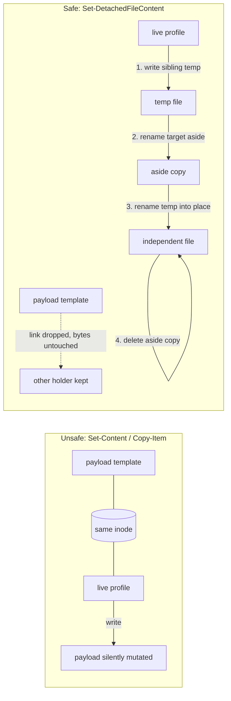
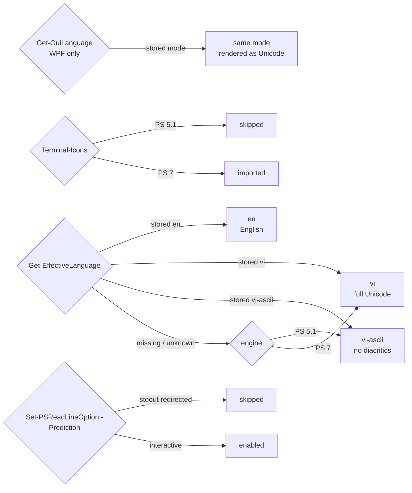
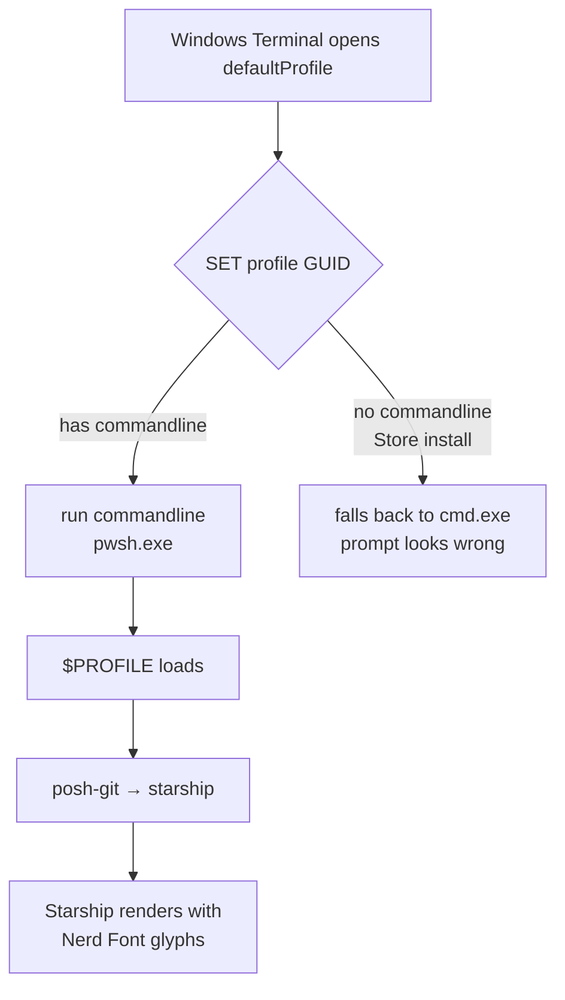

# Diagrams: Runtime Flows

**Doc ID**: DIAGRAMS-001  
Companion to `docs/ARCHITECTURE.md` (static topology) — this file holds the
**behavioural** diagrams. All diagrams are Mermaid and render in GitHub/VS Code.

---

## 1. Tri-Interface Parity Enforcement



Rule: a capability is real only when it exists in all three drivers **and** the
registry, in one commit.

---

## 2. Action Execution Engine (`Invoke-PSManagerAction`)



Cancellation path: `BtnCancelAction` → `Stop-PSManagerAction` → `Process.Kill()`
→ state cleared → `OnCompleted` never fires.

---

## 3. Sync Flow (with sandboxed test variant)



Tests use a temporary manifest with `type: copy`, temp targets, empty package
lists, and `PSMGR_E2E_TEST` instead of `STARSHIP_CONFIG`.

---

## 4. Profile Audit & Repair



---

## 4b. Hardlink Write-Through Hazard



---

## 5. Destructive Backup Cleanup

```mermaid
flowchart TD
    A[clean-backups / X / BtnDeleteBackups] --> B[List backups<br/>Get-PSManagerBackups]
    B -->|none| N[nothing to do]
    B --> C[Select: names | numbers | all]
    C --> D[Show destructive banner<br/>+ resolved file list]
    D --> E{interactive?}
    E -->|no and no -Force| REF[refuse, exit 1]
    E -->|yes| G{typed DELETE?}
    G -->|no| AB[abort, delete nothing]
    G -->|yes| H[Remove-PSManagerBackup]
    E -->|-Force| H
    H --> CG{path inside<br/>backups dir?}
    CG -->|no| SK1[skip + error]
    CG -->|yes| SP{matches<br/>profile_backup_*.zip?}
    SP -->|no| SK1
    SP -->|yes| DEL[Delete]
    DEL --> LOG[WARN: Backup cleanup: deleted=N]
```

---

## 6. Dual-Runtime Selection



---

## 7. Windows Terminal Launch Path



This is the exact failure mode that motivated `commandline: pwsh.exe` plus the
posh-git/starship ordering rule.
