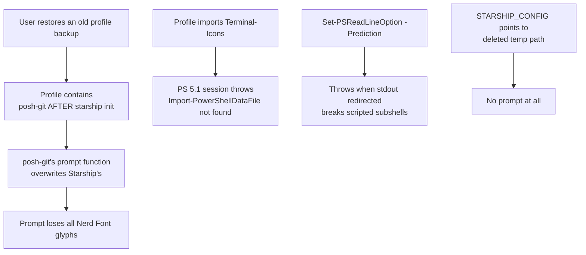

# Implementation Plan: Profile Compatibility Auditor & Repair

**Plan ID**: PLAN-PROFILE-AUDIT-001  
**Spec**: `docs/SPEC-PROFILE-AUDIT.md`  
**Status**: Complete  

---

## 1. Discovery (root-cause chain)

The feature exists because of a real regression observed in the field:



Each arrow is a check in `Test-PSManagerProfile` and a repair in
`Repair-PSManagerProfile`.

---

## 2. Work Breakdown

| Step | File | Change |
|------|------|--------|
| 1 | `modules/Sync/ProfileAuditor.ps1` | `Get-PSManagerProfileTargets`, `Test-ProfileBlockEnclosing`, `Test-PSManagerProfile`, `Repair-PSManagerProfile` |
| 2 | `PSManager.psm1` / `.psd1` | Load submodule, export both functions |
| 3 | `modules/Sync/SyncEngine.ps1` | Doctor check #8 + `-Fix` wiring |
| 4 | `modules/Core/ActionRegistry.ps1` | `audit-prof` entry |
| 5 | `ps-manager.ps1` | `audit-profile` action + `ValidateSet` |
| 6 | `modules/UI/TuiEngine.ps1` | `[T]` menu + `[F]` repair |
| 7 | `gui.ps1` | `BtnAuditProfiles` + bindings + handler |
| 8 | `i18n.json` | `menu_audit_prof*`, `gui_btn_audit_prof` (3 languages) |
| 9 | `templates/profiles/master_profile.ps1` | Canonical, audit-clean content |
| 10 | `tests/test_profile_auditor.ps1` | 4 cases |
| 11 | `tests/harness.ps1` | Export list + suite |

---

## 3. Guard-Detection Algorithm

The first implementation used `try\s*\{[^}]*...` which silently fails on
nested braces — the master template nests the import inside
`if (PSVersion -ge 7) { ... if (Get-Module Terminal-Icons) { ... } }`, so the
auditor reported false `FAIL`s (and the repair reported false `FIXED`s).

Replacement (`Test-ProfileBlockEnclosing`):

```
anchor   = first match of AnchorPattern
opener   = last match of OpenPattern before anchor
segment  = text between end-of-opener and anchor
balance  = 1                       # opener already consumed its '{'
for ch in segment:
    '{' -> balance++
    '}' -> balance-- ; if balance < 0 -> return $false   # block closed early
return $true
```

This handles single-line `if (...) { Import-... }`, multi-line nesting, and
`try { if (...) { ... } } catch {}` uniformly.

---

## 4. Verification Performed

| Gate | Command | Result |
|------|---------|--------|
| Profile audit suite | `tests/test_profile_auditor.ps1` (5.1 + 7) | 4/4 PASS |
| Live profile audit | `Test-PSManagerProfile` on synced profiles | 12/12 PASS |
| Doctor integration | `Invoke-PSManagerDoctor` | profile rows present |
| Tri-interface parity | `tests/test_interface_parity.ps1` | 23/23 PASS |
| Full harness | `tests/Run-Tests.ps1` (5.1 + 7) | 72/72 PASS |
| Static analysis | `Invoke-ScriptAnalyzer -Recurse` | 0 / 0 |
| Prompt regression | `(Get-Command prompt).Definition` on both engines | Starship active |

---

## 5. Rollback

Reverting the commit removes the checks. Profiles are only mutated by an
explicit `-Fix`, and every mutation is preceded by a
`<profile>.bak.<timestamp>` copy, so no repair is unrecoverable.
