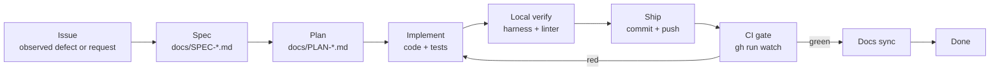
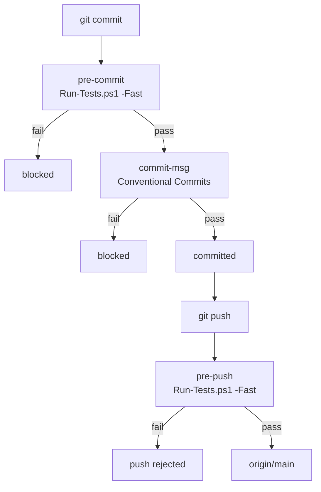
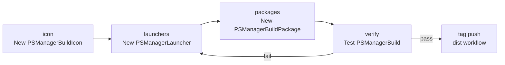

# SDLC: Development Lifecycle & Gates

**Doc ID**: SDLC-001  
**Applies to**: every change in this repository, human or agent.

---

## 1. Lifecycle



### Stage 1 — Issue
Capture the **observed** failure, not a guess. One file per incident:
`docs/ISSUE-<area>.md` with symptom, evidence, and suspected surface.

### Stage 2 — Spec
`docs/SPEC-<area>.md`. Numbered, testable requirements
(`FR-<PA>-<n>.<m>`). Must state non-goals explicitly so scope cannot drift.

### Stage 3 — Plan
`docs/PLAN-<area>.md`. Ordered work breakdown, safety ordering rationale,
verification matrix, and rollback.

### Stage 4 — Implement
- One logical change per commit.
- Parity rule: a user-facing capability lands in CLI **and** TUI **and** GUI
  **and** `ActionRegistry` in the *same* commit (`AGENTS.md` §1).
- Every destructive path needs a guardrail before its UI exists.

### Stage 5 — Local verify
```powershell
powershell -NoProfile -ExecutionPolicy Bypass -File tests/Run-Tests.ps1
pwsh       -NoProfile -ExecutionPolicy Bypass -Command "Invoke-ScriptAnalyzer -Path . -Settings ./PSScriptAnalyzerSettings.psd1 -Recurse"
powershell -NoProfile -ExecutionPolicy Bypass -Command "Test-ModuleManifest PSManager.psd1"
```
All three MUST be clean. The harness itself runs on both engines.

### Stage 6 — Ship
Git hooks (`core.hooksPath = .agents/hooks`):



Hooks enforce the fast validation profile (`tests/Run-Tests.ps1 -Fast`, ~5–8s: AST syntax across all files, manifest integrity, targeted `PSScriptAnalyzer` rule audit on changed files, tri-interface parity contract, and hook automation invariants), eliminating remote SSH/HTTPS timeouts during push. The full dual-engine test suite (`tests/Run-Tests.ps1` across both PS 5.1 and PS 7) remains the complete gate for manual verification and GitHub Actions CI.

### Stage 7 — CI gate
Never assume local green means remote green. After every push:

```powershell
gh run watch --exit-status
```

Fail-closed: a red run means the change is **not** shipped. Re-open Stage 4.

### Stage 8 — Docs sync
Same commit (or immediate follow-up if CI found a defect):
`README.md`, `CONTEXT.md`, `CHANGELOG.md` under `[Unreleased]`,
`docs/SPEC-*`, `docs/PLAN-*`, and this file when the process itself changes.


### Stage 9 — Build & package (release artifacts)

Artifacts are produced by the reusable builder (`docs/SPEC-BUILDER.md`), never by ad-hoc copy
commands:



`build/build.ps1 -Action all` runs the chain locally; the tagged workflow runs the same module.
Metadata (author, company, product, copyright, repository URL) and the icon are part of the
acceptance criteria, not decoration.
---

## 2. Gate Matrix

| Gate | Trigger | Command | Blocks |
|------|---------|---------|--------|
| G1 Syntax | every `.ps1/.psm1/.psd1` | AST parser (harness suite 1) | commit |
| G2 Lint | every change | `Invoke-ScriptAnalyzer` (changed files in hooks; `-Recurse` in CI/manual) | commit, push, CI |
| G3 Contract | manifest/API change | `Test-ModuleManifest`, export list | commit |
| G4 Parity | new capability | `tests/test_interface_parity.ps1` | commit |
| G5 Behaviour | every change | `tests/Run-Tests.ps1` (5.1 + 7 in CI / manual; `-Fast` in hooks) | commit, push, CI |
| G6 Safety | destructive feature | dedicated suite (e.g. `test_backup_cleanup.ps1`) | commit |
| G7 Remote | every push | `gh run watch --exit-status` | done |
| G8 Docs | `feat:` / `fix:` with code | `CHANGELOG.md` staged; README/CONTEXT updated | commit |

---

## 3. Test Suite Map

| Suite | File | Scope |
|-------|------|-------|
| 1 | inline AST + PSScriptAnalyzer | syntax & static analysis |
| 2 | `test_interface_parity.ps1` | 23-capability 3-way contract |
| 2 | `test_gui_async.ps1` | async GUI bridge, stream drain, XAML binding |
| 2 | `test_gui_keyboard.ps1` | GUI keyboard accessibility, shortcuts, radio groups, focus visuals |
| 2 | `test_e2e_sync.ps1` | sandboxed sync & doctor |
| 2 | `test_action_engine.ps1` | action execution engine |
| 2 | `test_profile_auditor.ps1` | profile compatibility audit/repair |
| 2 | `test_backup_cleanup.ps1` | destructive deletion guardrails |
| 3–7 | inline | config, sources, i18n, detection, sync, backup |

---

## 4. Destructive-Change Protocol

Any feature that **deletes or rewrites** user data MUST satisfy, in order:

1. **Containment** — resolved targets must live inside the expected root.
2. **Scope** — only files matching the intended pattern are eligible.
3. **Preview** — `SupportsShouldProcess` (`-WhatIf`) where the module is a cmdlet.
4. **Explicit intent** — typed confirmation (`DELETE`) or a gated confirm button.
5. **Fail-closed** — non-interactive contexts refuse without `-Force`.
6. **Audit trail** — a `WARN` log line per invocation.
7. **Restore path** — a timestamped `.bak` before mutating existing files.
8. **Link safety** — never write *through* a hard link. Live profiles may share
   an inode with `templates/profiles/master_profile.ps1`, so a plain
   `Set-Content` / `Copy-Item` silently rewrites the tracked repo payload. Use
   `Set-DetachedFileContent`: temp file → rename target aside → rename temp into
   place → delete the aside copy, rolling back if the swap fails. Never delete
   the target before the replacement is ready.
9. **Byte fidelity** — restoring a backup MUST reproduce the archived bytes
   (`-Bytes`), never decode and re-encode: a UTF-16 or ANSI file would be
   corrupted silently.
10. **Unambiguous selection** — a name token must resolve to exactly one object.
    Ambiguous tokens abort and list candidates, even under `-Force`; a selection
    that resolves to nothing aborts instead of proceeding.

Reference implementations: `Remove-PSManagerBackup`, `Set-DetachedFileContent`,
`Repair-PSManagerProfile`.

---

## 5. Roles & Artifacts

| Artifact | Owner | Lives in |
|----------|-------|----------|
| Issue | reporter | `docs/ISSUE-*.md` |
| Spec | implementer | `docs/SPEC-*.md` |
| Plan | implementer | `docs/PLAN-*.md` |
| Contract registry | implementer | `modules/Core/ActionRegistry.ps1` |
| Regression tests | implementer | `tests/` |
| Changelog | implementer | `CHANGELOG.md` |
| Process | maintainer | `AGENTS.md`, `docs/SDLC.md` |
